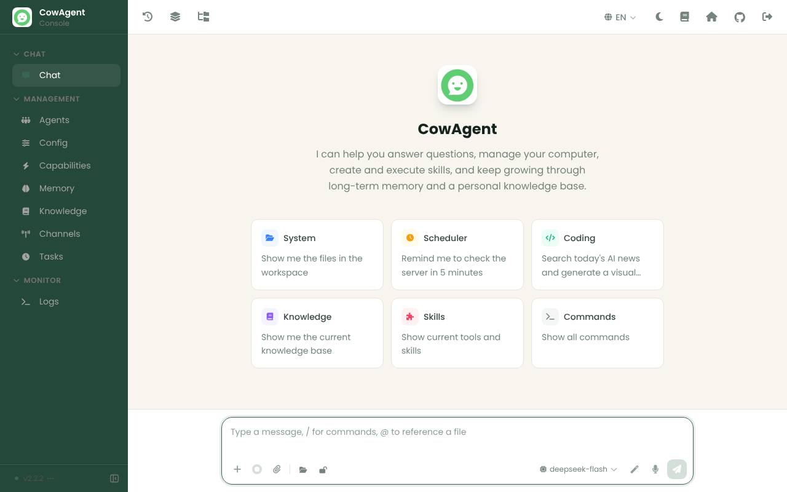

# lrmagents

Deploys [CowAgent](https://github.com/zhayujie/CowAgent) (web console, port 9899) to the same Tencent Lighthouse VPS as the `ln` demo (`43.152.240.47`, `int.lnint.xyz`).

- Public URL: `https://agent.lnint.xyz` now; `https://lrmcorporation.id` once that domain is switched on (see below). TLS terminates in the existing `ln` Caddy container, which reaches CowAgent over the shared `lnint-edge` Docker network.
- The CowAgent container is not on the `ln` network, so it cannot reach the `ln` PostgreSQL database.
- Workspace (skills, memory) and data (`config.json`, logs) live in Docker volumes `cowagent_workspace` and `cowagent_data`. They survive redeploys.

## Daily Dose look

The console is built from `deploy/Dockerfile`, a thin layer over the upstream image. It follows the Daily Dose v2 design baseline: sage-green brand `#396552`, cream canvas `#f8f5ef`, a deep-green sidebar, Poppins, and softer corners. It opens in light mode with the **Daily Dose** color theme. Viewers can still switch between light and dark, or pick another theme from the sidebar menu.



- `deploy/dailydose-theme/theme.json`: light and dark palettes, added as a built-in CowAgent color theme.
- `deploy/dailydose-theme/dailydose.css`: corners, focus ring, button weight.
- `deploy/dailydose-theme/apply.py`: patches the theme in at build. Each edit must match upstream exactly once, so an upstream change fails the deploy rather than shipping the stock look.
- `deploy/dailydose-theme/fonts/`: Poppins under the SIL Open Font License.

## One-time setup

1. **DNS (DNSPod, `lnint.xyz`):** add an `A` record with host `agent` and value `43.152.240.47`. Do not add an `AAAA` record.
2. **`ln` repo:** deploy the `ln` change that adds the `agent.lnint.xyz` site to `deploy/Caddyfile.domain` and joins Caddy to `lnint-edge`.
3. **This repo → Settings → Secrets and variables → Actions:**
   - Secret `VPS_SSH_KEY`: the same Tencent private key used by `lrmcorp/ln`.
   - Secret `COWAGENT_WEB_PASSWORD`: the web console password, 12 or more characters, including at least one letter (an all-digit value is parsed as a number). It is required because the agent can run shell commands inside its container.
   - Optional secrets for model keys: `CLAUDE_API_KEY`, `OPEN_AI_API_KEY`, `DEEPSEEK_API_KEY`, `GEMINI_API_KEY`. You can also set keys later in the web console.
   - Optional variable `COWAGENT_MODEL`, for example `claude-sonnet-4-5`.
   - Variable `VPS_DEPLOY_ENABLED=true`.
4. Run **Actions → Deploy CowAgent to Tencent Lighthouse → Run workflow**. Every push to `main` redeploys.

## Move the console to lrmcorporation.id

1. At the DNS provider for `lrmcorporation.id`, add `A` records for `@` and `www`, both pointing to `43.152.240.47`. Remove any `AAAA` records for those names.
2. In **both** `lrmcorp/ln` and `lrmcorp/lrmagents`, add the repository variable `AGENT_DOMAIN=lrmcorporation.id,www.lrmcorporation.id`.
3. Re-run the `ln` deploy workflow, which makes Caddy request certificates for the new hosts. Then re-run this repository's workflow, which updates the console's public URL and checks HTTPS.

`agent.lnint.xyz` stops being served after the switch. Delete the variable to go back to it.

## Access without the domain

```bash
ssh -i <tencent-key.pem> -L 9899:127.0.0.1:9899 ubuntu@43.152.240.47
```

Then open http://localhost:9899/.

## Operations (on the VPS)

```bash
cd ~/cowagent && sudo docker compose -f deploy/compose.yaml logs -f --tail 100
```

The base image tracks `zhayujie/chatgpt-on-wechat:latest`; each deploy rebuilds on the newest version. To pin a version, create `~/cowagent/deploy/.env` on the VPS containing `COWAGENT_IMAGE=zhayujie/chatgpt-on-wechat:<tag>`. Deploys keep that file.
