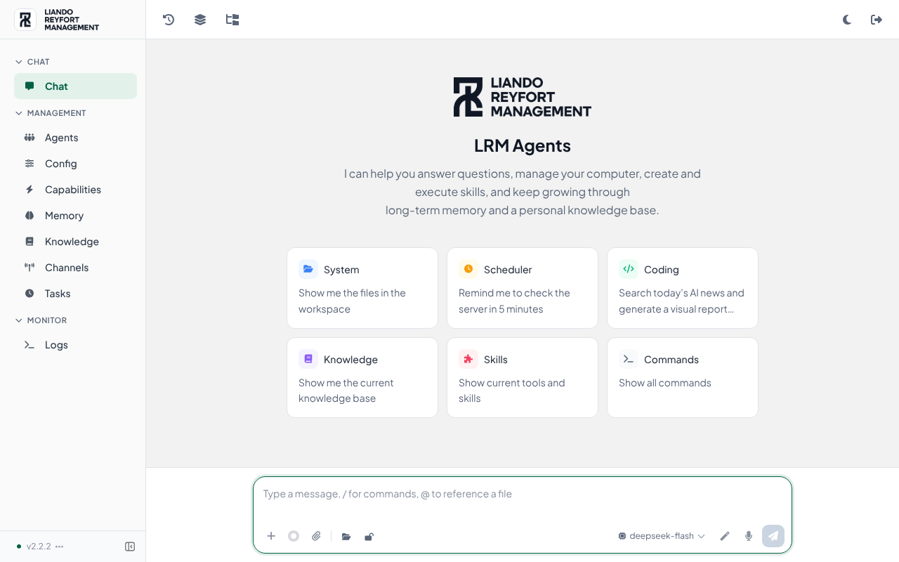

# lrmagents

Deploys **LRMagent**, the LRM agent console built on the open-source [CowAgent](https://github.com/zhayujie/CowAgent) (web console, port 9899), to the same Tencent Lighthouse VPS as the `ln` demo (`43.152.240.47`, `int.lnint.xyz`).

- Public URL: `https://agent.lnint.xyz` now; `https://lrmcorporation.id` once that domain is switched on (see below). TLS terminates in the existing `ln` Caddy container, which reaches LRMagent over the shared `lnint-edge` Docker network.
- The LRMagent container is not on the `ln` network, so it cannot reach the `ln` PostgreSQL database.
- Workspace (skills, memory) and data (`config.json`, logs) live in Docker volumes `cowagent_workspace` and `cowagent_data`. They survive redeploys.

## LRM brand and look

The console is built from `deploy/Dockerfile`, a thin layer over the upstream image. It is branded **LRMagent / Liando Reyfort Management** and follows the LRMsmm look:
- **Logo:** the wordmark appears on the login and welcome screens, and the RL mark is the favicon, the sidebar icon and the agent avatar.
- **Look:** a white sidebar with an emerald active item, a `#f1f2f1` canvas, white cards, `#015f44` primary buttons, and Plus Jakarta Sans.
- **Language:** English only, with no language switcher. `COW_LANG=en` makes the agent work in English too.
- **Name:** the agent calls itself LRMagent. Upstream docs, website and GitHub links are hidden.

It opens in light mode. Viewers can switch to the matching dark mode, which uses a dark sidebar.



- `deploy/brand/apply.py`: the build-time edits. Each must match upstream, so an upstream change fails the deploy rather than shipping upstream branding.
- `deploy/brand/theme.json`: light and dark palettes, added as the built-in **LRM** color theme.
- `deploy/brand/brand.css`: the light sidebar, logo sizing, hidden links, corners and focus ring.
- `deploy/brand/img/`: the logo, wordmarks and favicon, generated from the supplied LRM artwork.
- `deploy/brand/fonts/`: Plus Jakarta Sans under the SIL Open Font License.

## One-time setup

1. **DNS (DNSPod, `lnint.xyz`):** add an `A` record with host `agent` and value `43.152.240.47`. Do not add an `AAAA` record.
2. **`ln` repo:** deploy the `ln` change that adds the `agent.lnint.xyz` site to `deploy/Caddyfile.domain` and joins Caddy to `lnint-edge`.
3. **This repo → Settings → Secrets and variables → Actions:**
   - Secret `VPS_SSH_KEY`: the same Tencent private key used by `lrmcorp/ln`.
   - Secret `COWAGENT_WEB_PASSWORD`: the web console password, 12 or more characters, including at least one letter (an all-digit value is parsed as a number). It is required because the agent can run shell commands inside its container.
   - Optional secrets for model keys: `CLAUDE_API_KEY`, `OPEN_AI_API_KEY`, `DEEPSEEK_API_KEY`, `GEMINI_API_KEY`. You can also set keys later in the web console.
   - Optional variable `COWAGENT_MODEL`, for example `claude-sonnet-4-5`.
   - Variable `VPS_DEPLOY_ENABLED=true`.
4. Run **Actions → Deploy LRMagent to Tencent Lighthouse → Run workflow**. Every push to `main` rebuilds and redeploys automatically.

## Move the console to lrmcorporation.id

1. At the DNS provider for `lrmcorporation.id`, add `A` records for `@` and `www`, both pointing to `43.152.240.47`. Remove any `AAAA` records for those names.
2. In **both** `lrmcorp/ln` and `lrmcorp/lrmagents`, add the repository variable `AGENT_DOMAIN=lrmcorporation.id,www.lrmcorporation.id`.
3. Re-run the `ln` deploy workflow, which makes Caddy request certificates for the new hosts. Then re-run this repository's workflow, which updates the console's public URL and checks HTTPS.

`agent.lnint.xyz` stops being served after the switch. Delete the variable to go back to it.

## Switch models by asking

Every agent has a `switch_model` tool (`deploy/agent-tools/model_switch/`), so you can say things like "which models can you use?", "switch to Claude Sonnet", "use gpt-5.5 from now on", or "go back to the default model".

- **Allowed models:** only providers with an API key on file are offered, the same list as the console's model picker. A family name such as "claude sonnet" picks that family's newest model. A name that is too broad ("gpt") makes the agent ask which one.
- **This chat** (the default): the switch takes effect on the next model call and lasts for that conversation, including WhatsApp chats. "Go back to the default" clears it.
- **As the agent's default** ("from now on", "make it the default"):
  - For the main agent, this saves the global model (Config → Models).
  - For any other agent, it saves that agent's default model (Agents page).
- **Team chats:** each agent keeps its own model, as in the console.

## WhatsApp (QR link, one number per agent)

`whatsapp-gateway/` links WhatsApp numbers through **WhatsApp Web**, using Baileys `7.0.0-rc14`, the same library and version OpenClaw pins. Each agent can have its own number.

- **Link:** open **WhatsApp** in the console sidebar (under Channels). Click **Link WhatsApp** on an agent and scan the QR from the phone: Settings → Linked devices → Link a device. The QR refreshes itself, and an unscanned login stops after 3 minutes.
- **Who can talk:** each agent has a "Who can talk to this agent" panel.
  - Direct messages default to **pairing**: a stranger gets an 8-character code (valid 1 hour, at most 3 waiting), and you approve it on the WhatsApp page. Other options are allowlist only, anyone, or nobody.
  - Groups are ignored by default. Set them to answer only when the number is @mentioned or replied to, and only for approved senders.
  - On the linked phone, **Message yourself** always reaches the agent.
- **Conversations:** each WhatsApp chat keeps its own conversation with its agent, through LRMagent's API and a token generated on the VPS.
- **Replies:**
  - Markdown is converted to WhatsApp formatting.
  - Long replies are split into parts with short pauses between them.
  - The sender sees read ticks and "typing…" while the agent works.
  - Media without a caption gets a short "text only for now" reply.
- **Sessions:** stored in the `cowagent_whatsapp` Docker volume, so redeploys keep numbers linked. A dropped link reconnects with backoff (2 s, growing to 30 s, 12 tries). Unlinking from the phone is detected and the session is wiped.
- **Sign-in:** the page uses the console's own login (the gateway checks the console session cookie). Writes must come from the page itself.

- **Reminders and scheduled tasks** set up in a WhatsApp chat ("remind me at 5pm") are delivered back to that chat through the gateway. If the number is disconnected at that moment, the scheduler retries on its next tick; a retry never sends a reminder twice. The agent can only start messages to chats that wrote to it, approved numbers, or your own chat. It cannot message strangers.
- **Files from the agent:** images it generates and files it sends arrive as WhatsApp photos and documents (up to 16 MB), not as links.
- **Photos and voice notes:** the gateway saves them to a shared media volume that the agent can read but not write. Photos go to the vision tool. Voice notes go to `transcribe_audio`, which uses the Speech Recognition provider set in Config → Models. Files are kept 7 days. Video, documents and stickers are answered only through their caption.
- **Groups:** when the agent is @mentioned, it also sees up to the last 20 messages from **approved** members that it wasn't asked about (within 6 hours), so it can follow the conversation.
- **Rate limit:** at most 8 messages per minute per chat and 40 per number. A sender who goes over is told once, then ignored until the minute passes. "Message yourself" is never limited.
- **Permissions:** WhatsApp chats run with **workspace-write** permission, because WhatsApp senders are less trusted than you in the console. In fact every conversation over the chat API is held to that level and can't be raised to full access. A WhatsApp chat can switch its own model, but not the default. Console chats keep your default.
- **Remaining risk:** the agent's shell commands run as the same user as LRMagent itself, so a chat that can run commands could in principle read the console password. LRMagent's permission checks are not an operating-system sandbox. Approve only people you trust, and keep "Who can talk" on pairing or allowlist.

**Risk:** WhatsApp does not support bots on WhatsApp Web. Use a dedicated number and avoid bulk or spam-like messaging, or the number can be banned.

## Second brain (Obsidian vault, low-token recall)

- The agent's knowledge base (`knowledge/`) is kept as an **Obsidian-compatible vault**: YAML properties on every page, `[[wikilinks]]` between pages, and a `## Related` section, with `index.md` as the map of content. Older relative Markdown links keep working.
- **Vault page** (console sidebar → Vault, in place of Memory and Knowledge, which you can show again with the menu editor): each agent's `MEMORY.md`, daily notes (`memory/`) and knowledge wiki in one Obsidian-style workspace.
  - **Explorer:** file tree with new note/folder, rename, move (drag onto a folder) and delete.
  - **Notes:** tabs; reading and editing views (Ctrl/⌘ E); `[[` link suggestions; properties, callouts, embeds (`![[note]]`, images), `#tags`, highlights and clickable tasks.
  - **Links:** backlinks, outgoing links and outline in the right pane; clicking a link to a note that doesn't exist creates it.
  - **Graph view:** whole vault or one note's neighbourhood, coloured by folder.
  - **Finding notes:** full-text search (`tag:#name` too), quick switcher (Ctrl/⌘ O), command palette (Ctrl/⌘ P) and today's daily note.
  - **Saving:** edits save automatically. If the agent changed the same note meanwhile, you choose which version to keep. Notes the agent changes while open refresh by themselves.
  - **Renames and deletes:** renaming or moving a note rewrites the links that point to it. Deleted files go to `.trash/` in the agent's workspace, not away. `knowledge/index.md` and `log.md` are the agent's own and read-only here.
  - **Search index:** saves feed the same memory search the agent uses.
  - **Per agent:** pick the agent at the top. One that reads the shared knowledge base shows it as SHARED.
- Skills vendored from [kepano/obsidian-skills](https://github.com/kepano/obsidian-skills) (MIT, `deploy/skills/`):
  - `obsidian-markdown`: callouts, embeds, properties.
  - `json-canvas`: visual maps.
  - `obsidian-bases`: table views.

  `obsidian-cli` needs the desktop app, and `defuddle` and `knap` need extra CLIs, so they are left out.
- **Recall:** LRMagent's `memory_search` already does hybrid keyword and vector search with a reranker over memory and the vault, returning short snippets. Its default is lowered from 10 to 6 results, OpenClaw's setting. The knowledge-wiki skill now says to search first and read only the page or lines needed.
- **Khoj is not deployed.** It would duplicate this search, and it needs about 1.2–1.7 GB more RAM (Django, torch and pgvector) on a 4 GB VPS that also runs the `ln` app, plus a sync job to push notes into it. Revisit it if the VPS gets more memory.
- **Embeddings:** configure a provider (Config → Models → Embedding). Without one, recall falls back to keyword search.

### Open the vault in Obsidian (hourly two-way sync)

The vault can be synced with a **private** GitHub repo, so you can read and edit it in Obsidian on desktop or phone (for example with the Obsidian Git plugin).

1. Create an empty **private** repository, for example `lrmcorp/lrmagent-vault`. This repo (`lrmagents`) is public, so it must not hold the vault.
2. In this repo, add the Actions variable `LRMAGENT_VAULT_REPO=lrmcorp/lrmagent-vault` and run the deploy.
3. The deploy summary shows a public key generated on the VPS. Add it under the vault repo's Settings → Deploy keys, **with write access**. The private key never leaves the VPS.

Only the synced folders below are written from the server; `.obsidian/`, notes at the top level and any other folders are left as Obsidian keeps them. A folder created in Obsidian for an existing agent (`agents/<id>/knowledge/`) is created on the server too.

Every hour at :41, `deploy/vault-sync.sh`:
- commits the agents' changes;
- merges them with your Obsidian edits using git;
- pushes the result, and writes your edits back to the agents.

If one note was changed on both sides, your Obsidian version wins and the agent's version is kept beside it as `note (agent copy <date>).md`, so nothing is lost. The synced folders are `knowledge/` (shared) and `agents/<id>/knowledge/` (agents with their own vault). Remove the variable to stop syncing.

## Usage and cost

**Usage** (under Monitor in the sidebar) shows tokens and model calls per agent, model and channel for today, 7 days and 30 days. That covers the console, WhatsApp, other channels, scheduled tasks and sub-agents. Data: `lrm_usage.sqlite` in the data volume.

Cost is shown once you set the Actions variable `LRMAGENT_PRICES`, in USD per million input and output tokens, matched by model-name prefix. For example:

```json
{"claude-sonnet": [3, 15], "gpt-5.5": [1.25, 10]}
```

Take the numbers from your providers' price pages; there is no built-in price list because prices change. Your invoice is the authority.

## Reliability

- **Backup model:** set a fallback chain in Config → Models → Main Model → Fallback. Alternatively, set the Actions variable `LRMAGENT_MODEL_FALLBACK`, for example `claudeAPI:claude-sonnet-5-5,openai:gpt-5.5`, so it survives rebuilds.
- **Nightly backups:** at 02:17 Jakarta time, `deploy/backup.sh` saves the `cowagent_workspace` (memory, vault, skills), `cowagent_data` (settings) and `cowagent_whatsapp` (sessions) volumes to `~/backups/lrmagent` on the VPS. It keeps 7 days, and the folder is readable only by `ubuntu` because it contains keys. To restore one volume, stop the stack and run:

  ```bash
  cd ~/cowagent && sudo docker compose -f deploy/compose.yaml stop
  sudo docker run --rm -v cowagent_workspace:/v -v ~/backups/lrmagent:/b:ro alpine:3.20 sh -c 'rm -rf /v/* && tar -C /v -xzf /b/cowagent_workspace-YYYYMMDD-HHMM.tar.gz'
  sudo docker compose -f deploy/compose.yaml up -d
  ```

  **Off-site copy:** with the vault repo set up, add the secret `LRMAGENT_BACKUP_PASSPHRASE`. Each night's archives are then encrypted (AES-256) and pushed to the vault repo's `backups` branch, keeping only the latest night. Keep the passphrase somewhere safe; without it the copy can't be opened. To restore from it:

  ```bash
  git clone -b backups git@github.com:lrmcorp/lrmagent-vault.git restore && cd restore
  openssl enc -d -aes-256-cbc -pbkdf2 -iter 200000 -in lrmagent-backup-*.tar.gz.enc | tar -x
  ```

  Then restore each volume as shown above.
- **Health alerts:** every 15 minutes, the **LRMagent health** workflow checks:
  - the console and containers;
  - linked WhatsApp numbers (logged out on the phone, or unable to reconnect);
  - AI model failures (3 or more failed model calls in 15 minutes: key, credit or provider);
  - disk space;
  - the last backup;
  - vault sync errors;
  - public HTTPS.

  On a problem it opens a GitHub issue titled *LRMagent health alert*, which GitHub emails you, and comments only when the problem changes. It closes the issue when everything is healthy again.
- **Weekly update check:** every Monday the **LRMagent update check** workflow compares the pinned agent image and WhatsApp library with the newest releases, and opens an issue titled *LRMagent update available* when something new is out. Nothing is updated automatically.
- **Tests before deploy:** every push first runs the gateway tests and syntax checks, then builds both images, which applies every brand patch. Nothing reaches the VPS unless all of that passes.
- **Login lockout:** 5 wrong passwords lock out only the address that typed them, for 10 minutes, not everyone.
- **Locked settings:** the console password (the `COWAGENT_WEB_PASSWORD` secret), the listen address and in-place updates are managed by the deployment. They are hidden in the console and refused by the server. Passwords and tokens are masked in the logs.

## Updating the upstream version

The base image is pinned by digest in `deploy/compose.yaml` and `deploy/Dockerfile`, so deploys never pick up an untested upstream release. To update:
1. Pull the new `zhayujie/chatgpt-on-wechat` image locally.
2. Copy its digest into both files.
3. Run `docker compose -f deploy/compose.yaml build`. `apply.py` stops the build if anything it patches moved.
4. Fix any patch the build reports, then push.

## Access without the domain

```bash
ssh -i <tencent-key.pem> -L 9899:127.0.0.1:9899 ubuntu@43.152.240.47
```

Then open http://localhost:9899/.

## Operations (on the VPS)

```bash
cd ~/cowagent && sudo docker compose -f deploy/compose.yaml logs -f --tail 100
```

Logs: `~/backups/lrmagent-backup.log` (backups) and `~/vault-sync/sync.log` (vault). The base image is pinned (see "Updating the upstream version").
